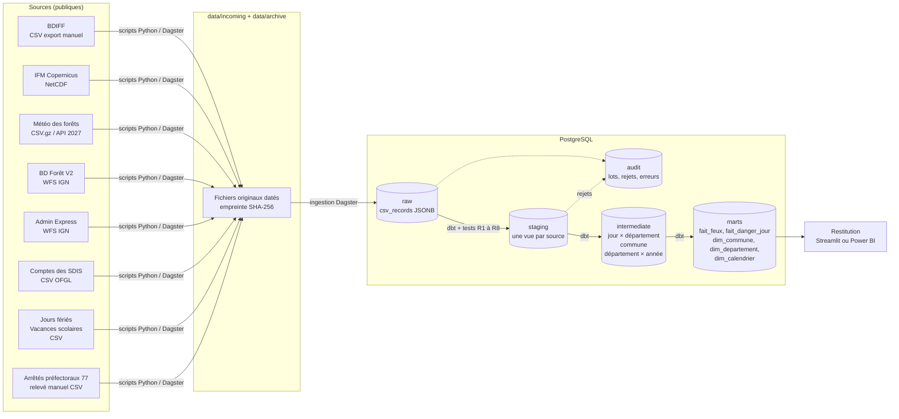

# Architecture — Feux de forêt en Île-de-France

Groupe : Destiné BEHANZIN · Sandrine YAO · Audrey MOBOU · Version du 2026-11-20 (brouillon, à valider par Audrey MOBOU, responsable pipeline)

> Ce schéma détaille la section 10 de `docs/specification.md`. Les noms de tables sont des propositions.

## Schéma

## Rôle de chaque couche

| Couche | Ce qui s'y passe | Outil |
|---|---|---|
| `data/incoming`, `data/archive` | Dépôt des fichiers tels que reçus ; archive datée pour retraiter sans rappeler les sources | Python, Dagster |
| `raw` | Une ligne par enregistrement source, contenu brut en JSONB, nom du fichier, date de chargement, empreinte | PostgreSQL, Dagster |
| `audit` | Traçabilité : lots chargés, lignes rejetées par les règles R1 à R8, erreurs | PostgreSQL |
| `staging` | Typage, codes département sur 2 caractères, `date_cible` de la Météo des forêts, surfaces en hectares, OFGL filtré (`CBUDG` = `1`) et pivoté, jours fériés dédoublonnés | dbt |
| `intermediate` | Croisement des sources au même grain : jour × département, commune, département × année | dbt |
| `marts` | Tables stables lues par les indicateurs et la restitution | dbt |
| Restitution | Carte des communes, calendrier d'activation, tableau des seuils, classement des départements | Streamlit ou Power BI (à trancher) |

## Grains et clés de jointure

| Table `intermediate` | Grain | Sources croisées | Clés |
|---|---|---|---|
| `int_danger_feux_jour_dep` | un département × un jour | Météo des forêts, IFM, BDIFF, jours fériés, vacances, arrêtés | `code_departement`, `date` (date cible pour la Météo des forêts, date d'alerte pour la BDIFF) |
| `int_commune` | une commune | BDIFF, BD Forêt, Admin Express | `code_insee` |
| `int_departement_annee` | un département × une année | BDIFF, OFGL, Admin Express | `code_departement`, `annee` |

## Questions servies

| Question | Tables `marts` lues |
|---|---|
| Q1 — où concentrer les moyens | `fait_feux`, `dim_commune`, `dim_calendrier` |
| Q2 — à partir de quel niveau déclencher | `fait_danger_jour`, `fait_feux`, `dim_calendrier` |
| Q3 — le seuil actuel convient-il | `fait_danger_jour`, `fait_feux` |
| Q4 — position du 77 | `fait_feux`, `fait_danger_jour`, `dim_departement` |
